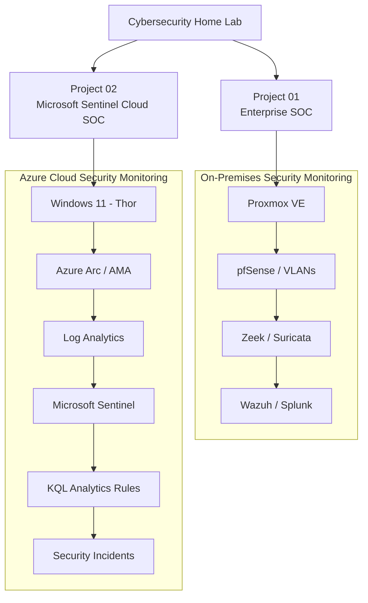

# Hello, I'm Amal

MSc Cyber Security graduate focused on **SOC Operations, Threat Detection, Incident Investigation, Cloud Security, Network Security, and Security Engineering**.

I build hands-on cybersecurity labs to develop practical experience with **SIEM, detection engineering, KQL, IDS/IPS, network traffic analysis, security-event correlation, and defensive security controls**.

My portfolio includes both **on-premises enterprise SOC infrastructure** and **Microsoft Azure cloud SIEM monitoring**, with ten completed security investigations across two projects.

---

## Career Objective

My goal is to build a career in **SOC Analysis, Cyber Security Analysis, and Security Engineering**, with a long-term interest in cloud security.

I focus on designing security environments, generating controlled attack simulations, analysing telemetry, developing detections, investigating incidents, and validating defensive controls.

---

## Featured Projects

### 01 - Enterprise SOC & Network Security Lab

**Status: Completed**

An enterprise-style SOC and network security environment designed for **security monitoring, threat detection, incident investigation, network segmentation, and defensive security validation**.

**Technologies**

`Splunk` `Wazuh` `Zeek` `Suricata` `pfSense` `Proxmox` `MITRE ATT&CK` `Tailscale`

**Implemented**

- pfSense firewall and inter-VLAN security policies
- VLAN-based network segmentation
- Dedicated network IDS sensor with SPAN/port mirroring
- Zeek network security monitoring
- Suricata IDS/IPS and custom detection rules
- Splunk SIEM and Wazuh endpoint monitoring
- Wazuh-to-Splunk alert integration
- Centralised SOC monitoring dashboards
- Secure remote access using Tailscale
- Controlled security simulations and incident investigations

**Completed Investigations**

| Investigation | Focus |
|---|---|
| 01 — Phishing | Phishing analysis and investigation |
| 02 — SSH Brute Force | Authentication attack detection |
| 03 — Network Reconnaissance | Network scanning and traffic analysis |
| 04 — Cross-VLAN Access | Firewall policy and segmentation validation |
| 05 — Suricata IDS/IPS | Intrusion detection and prevention validation |

**[View Enterprise SOC & Network Security Lab](https://github.com/CyberAmal/enterprise-soc-security-lab)**

---

### 02 - Microsoft Sentinel Cloud SOC & Threat Detection Lab

**Status: Completed — 5 Security Investigations**

A hybrid cloud SOC project integrating a **Proxmox-hosted Windows 11 endpoint with Microsoft Azure** using Azure Arc and Azure Monitor Agent.

Developed custom KQL detection rules, collected Windows security telemetry, and validated automatic alert and incident generation in Microsoft Sentinel.

**Technologies**

`Microsoft Sentinel` `Azure Arc` `Azure Monitor Agent` `Log Analytics` `KQL` `Microsoft Defender` `Windows 11` `Proxmox`

**Implemented**

- Microsoft Sentinel and Azure Log Analytics
- Azure Arc integration for a non-Azure Windows endpoint
- Azure Monitor Agent and Data Collection Rules
- Windows Security, PowerShell, and Defender event collection
- Custom KQL scheduled analytics rules
- Windows security event correlation
- SID-based correlation of account creation and privileged group membership events
- Automatic security alert and incident generation
- Host entity mapping and incident validation
- Troubleshooting Windows audit policies, Data Collection Rules, and Sentinel detection issues
- MITRE ATT&CK technique mapping

**Completed Investigations**

| Investigation | Event IDs | MITRE ATT&CK |
|---|---|---|
| 01 — Repeated Windows Failed Logons | 4625 | T1110 |
| 02 — Suspicious PowerShell Activity | 4104 | T1059.001 |
| 03 — Microsoft Defender Malware Detection | 1116, 1117 | Endpoint Detection |
| 04 — Account Creation & Privilege Escalation | 4720, 4732 | T1136.001, T1098 |
| 05 — Scheduled Task Persistence | 4698 | T1053.005 |

**Results:** Five detection scenarios validated, with Microsoft Sentinel incidents generated automatically and the monitored endpoint identified through Host entity mapping.

**[View Microsoft Sentinel Cloud SOC Lab](https://github.com/CyberAmal/microsoft-sentinel-cloud-soc)**

---

## SOC Lab Architecture Overview

*The diagram summarises two separate portfolio projects and their monitoring architectures.*

---

## Technical Skills

| Category | Technologies & Skills |
|---|---|
| SIEM & SOC | Microsoft Sentinel, Splunk, Wazuh |
| Detection Engineering | KQL, Security Analytics Rules, Event Correlation |
| Cloud Security | Microsoft Azure, Azure Arc, Azure Monitor, Log Analytics |
| Endpoint Security | Microsoft Defender, Windows Event Logs, PowerShell Logging |
| Network Security | pfSense, VLANs, Zeek, Suricata, Wireshark |
| Incident Response | Alert Triage, Threat Detection, Incident Investigation |
| Security Frameworks | MITRE ATT&CK |
| Systems & Virtualisation | Windows, Linux, Proxmox VE |
| Scripting | Python, PowerShell |

---

## Tools & Technologies

### SIEM & Cloud Security

### Network Security

### Detection & Analysis

### Systems & Infrastructure

### Scripting

---

## Certifications

- **CompTIA Security+**
- **CompTIA A+**
- **Microsoft MTA - Introduction to Programming Using Python**

---

## Hands-On Training

### TryHackMe - SOC Level 1

- Completed **40+ hands-on SOC labs**
- Investigated **15 simulated security incidents**
- Practised SIEM operations, threat detection, and incident response
- Investigated phishing, Windows/Linux security events, and network activity
- Applied MITRE ATT&CK during security investigations

---

## Project Roadmap

| Project | Focus | Status |
|---|---|---|
| 01 - Enterprise SOC & Network Security Lab | SIEM, IDS/IPS, network security, investigations | Completed |
| 02 - Microsoft Sentinel Cloud SOC Lab | Azure monitoring, KQL, detection engineering | Completed |
| 03 - Azure Cloud Security | Identity, network security, monitoring, hardening | Planned |

---

## Education

**MSc Cyber Security with Advanced Research**  
University of Hertfordshire, United Kingdom

**BSc Computer Science**  
University of Calicut, India

---

## Connect With Me

I'm building my career in **SOC Operations, Cyber Security Analysis, and Security Engineering**, supported by practical blue-team and cloud security projects.

